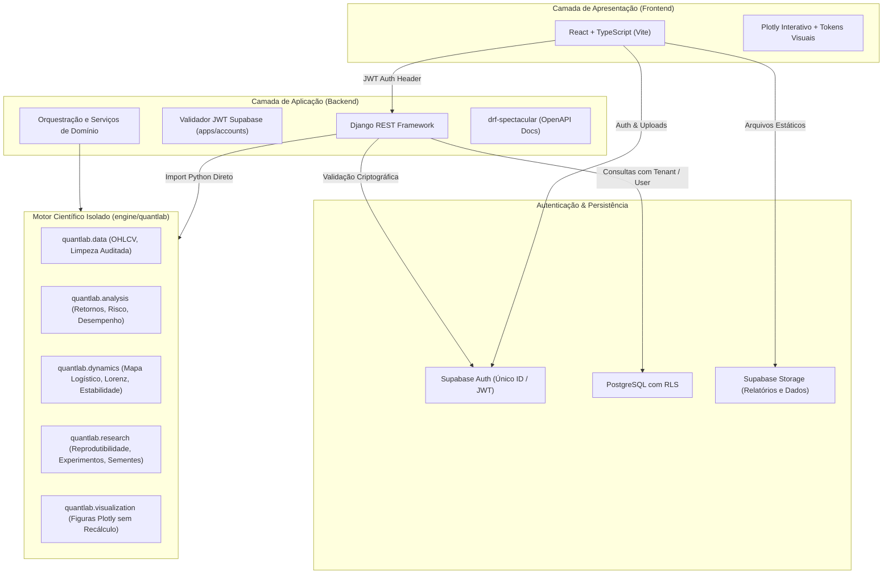

# QuantLab — Plano Geral de Desenvolvimento

Documento mestre de acompanhamento e guia de engenharia para o desenvolvimento completo do **QuantLab (Quantitative Finance & Computational Dynamics)**.

---

## 1. Visão do Projeto e Arquitetura

O **QuantLab** é uma plataforma que integra **Finanças Quantitativas** e **Sistemas Dinâmicos**. O princípio orientador é a **reprodutibilidade e correção matemática antes de qualquer camada de apresentação ou otimização prematura**.

### Regras Arquiteturais Fundamentais
1. **RULE 002 (Isolamento do Motor):** O pacote `engine/quantlab` não depende nem importa Django, DRF, Supabase, React, bibliotecas HTTP (`requests`, `httpx`, `aiohttp`, `urllib3`), nem Celery/Redis. Isso é garantido por análise de AST em `tests/test_architecture.py`.
2. **RULE 017 & 040 (Auditabilidade dos Dados):** Nenhum dado de mercado é corrigido ou preenchido silenciosamente. Toda limpeza gera um `CleaningReport` com métricas auditáveis guardado junto com o experimento.
3. **RULE 024 & 025 (Identidade Única via Supabase Auth):** O Django não mantém cadastro de usuários duplicado. O backend apenas valida a assinatura (com as chaves públicas do projeto, JWKS, algoritmo ES256) e as claims do JWT (`sub`, `iss`, `aud`, `exp`). Nenhum segredo de assinatura é guardado ([ADR 0007](adr/0007-chaves-supabase-jwks-e-frontend.md)).
4. **RULE 027 (Row Level Security):** Todas as tabelas que contêm dados privados possuem RLS ativado no PostgreSQL por padrão, validando `auth.uid() = user_id`.

---

## 2. Diagnóstico de Estado: O Que Está Feito vs. O Que Falta

### Tabela de Progresso por Módulo

| Módulo / Camada | Subcomponente | Situação | Testes & Qualidade |
|---|---|---|---|
| **Motor Científico** | Validação central e Exceções | ✅ Concluído | 100% Cobertura (`_validation.py`, `exceptions.py`) |
| **Motor Científico** | `quantlab.analysis` (Retornos, Volatilidade, Risco, Drawdown, Médias, Correlação) | ✅ Concluído | 100% Cobertura (158 testes dedicados) |
| **Motor Científico** | `quantlab.data` (Schema OHLCV, CsvProvider, Limpeza auditada) | ✅ Concluído | 100% Cobertura (55 testes dedicados) |
| **Motor Científico** | `quantlab.dynamics` (Mapa logístico, órbitas, estabilidade, Lyapunov) | ✅ Concluído | 100% Cobertura (76 testes dedicados) |
| **Motor Científico** | `quantlab.visualization` (Gráficos financeiros com tokens e Plotly) | ✅ Concluído | 100% Cobertura (20 testes dedicados) |
| **Motor Científico** | `quantlab.dynamics` (Sistema contínuo de Lorenz, integração adaptativa DOP853, estabilidade de equilíbrios de fluxos) | ✅ Concluído | 100% Cobertura (135 testes dedicados; ADR 0004) |
| **Motor Científico** | `quantlab.research` (Research Core: sementes, experimentos, hash de dados, reprodução) | ✅ Concluído | 100% Cobertura (143 testes dedicados; ADR 0006). Pendente: artefatos e `CleaningReport` serializado, que dependem do Storage |
| **Conectores** | `quantlab_connectors.yahoo`: provedor online do Yahoo Finance (fora do motor, ADR 0005) | ✅ Concluído | 100% Cobertura (65 testes sem rede, mais 4 de contrato com `-m network`) |
| **Motor Científico** | Cache DuckDB/Parquet dos dados baixados | ⏳ **Pendente** | Recomendado no ADR 0002; necessário para reproduzir resultados, pois o Yahoo revisa preços |
| **Motor Científico** | `quantlab.visualization` (Atrator de Lorenz 3D, Diagrama de Bifurcação) | ✅ Concluído | 100% Cobertura (37 testes dedicados: 19 dos gráficos e 18 do diagrama no motor) |
| **Supabase** | Projeto de desenvolvimento e chaves no `.env` local | 🔧 Configurado (sem código) | Verificado localmente em 2026-11-20: URL, chave `anon` e projeto consistentes; o projeto publica uma chave ES256 em JWKS (ADR 0007). `DATABASE_URL` ainda é exemplo |
| **Supabase** | Migrações SQL e Esquema Relacional | ⏳ **Pendente** | Estruturação de `supabase/migrations/` |
| **Supabase** | Políticas de RLS e Buckets de Storage | ⏳ **Pendente** | RLS e configuração de storage |
| **Backend Django** | Setup do Projeto e Configuração Modular | ⏳ **Pendente** | Diretório `backend/` e settings |
| **Backend Django** | Validação JWT do Supabase (`apps/accounts`) | ⏳ **Pendente** | Auth provider do Django sem duplicação |
| **Backend Django** | APIs de Orquestração REST e OpenAPI (`drf-spectacular`) | ⏳ **Pendente** | Endpoints de análise, dinâmica e pesquisa |
| **Frontend** | Setup React + TypeScript (Vite) + Tailwind | ⏳ **Pendente** | Diretório `frontend/` e tokens visuais. Hoje só existem `package.json` e `node_modules/` na raiz, com os clientes do Supabase |
| **Frontend** | Integração Supabase Auth | ⏳ **Pendente** | Fluxo de autenticação e proteção de rotas |
| **Frontend** | Telas de Análise Quantitativa e Gráficos Plotly | ⏳ **Pendente** | Dashboards de ativos, drawdown, distribuição |
| **Frontend** | Telas de Sistemas Dinâmicos (Mapa Logístico & Lorenz 3D) | ⏳ **Pendente** | Controles interativos de parâmetros e canvas |
| **Frontend** | Painel do Laboratório de Pesquisa | ⏳ **Pendente** | Gestão de hipóteses e histórico de experimentos |

---

## 3. Roteiro Passo a Passo de Implementação (Roadmap)

### Fase 1: Conclusão da Fundação Científica e Research Core

#### 1.1. Sistema de Lorenz (`engine/quantlab/dynamics/lorenz.py`)
- **Equações diferenciais governantes:**
  $$\frac{dx}{dt} = \sigma(y - x), \quad \frac{dy}{dt} = x(\rho - z) - y, \quad \frac{dz}{dt} = xy - \beta z$$
- **Parâmetros canônicos:** $\sigma = 10$, $\beta = 8/3$, $\rho = 28$.
- **Integração numérica:** `scipy.integrate.solve_ivp` com controle adaptativo de erro local. Decisão final ([ADR 0004](adr/0004-integracao-numerica.md)): `DOP853` por padrão, com `RK45` e `Radau` disponíveis.
- **Estabilidade:** Cálculo dos pontos fixos (origem e os dois centros $C^{\pm} = (\pm \sqrt{\beta(\rho-1)}, \pm \sqrt{\beta(\rho-1)}, \rho-1)$ para $\rho > 1$) e análise dos autovalores da matriz jacobiana.
- **Entregáveis (✅ concluídos):**
  - Código: `engine/quantlab/dynamics/lorenz.py`, com o integrador genérico em `engine/quantlab/dynamics/integration.py` e a estabilidade de fluxos em `engine/quantlab/dynamics/stability.py`
  - Testes: `tests/dynamics/test_lorenz.py`, `tests/dynamics/test_integration.py`, `tests/dynamics/test_flow_stability.py`
  - Documentação matemática: `docs/math/sistema-lorenz.md`

#### 1.2. Research Core (`engine/quantlab/research/`)
- **Objetivo:** Garantir a reprodutibilidade absoluta (RULE 017 e RULE 018).
- **Componentes:**
  - `SeedManager`: gerenciamento explícito de sementes via `numpy.random.Generator`.
  - `Experiment`: classe imutável que registra hipótese, parâmetros, versão do motor, semente, hash dos dados de entrada (`data_hash`) e carimbo de data/hora.
  - `ExperimentRun`: resultado da execução com métricas consolidadas e referências a artefatos.
- **Entregáveis (✅ concluídos, [ADR 0006](adr/0006-research-core.md)):**
  - Código: `engine/quantlab/research/experiment.py`, `engine/quantlab/research/seeds.py` e `engine/quantlab/research/hashing.py` (impressão digital dos dados, o `data_hash`)
  - Testes: `tests/research/test_experiment.py`, `tests/research/test_seeds.py`, `tests/research/test_hashing.py`
  - **Fora do escopo desta entrega, pendentes:** referências a artefatos em `ExperimentRun` e a serialização do `CleaningReport` junto do experimento. Dependem do bucket `experiment-artifacts` (Fase 3.2).

#### 1.3. Visualizações de Sistemas Dinâmicos (`engine/quantlab/visualization/dynamics.py`)
- Trajetória 3D interativa do Atrator de Lorenz via `plotly.graph_objects.Scatter3d` com o tema visual do QuantLab.
- Diagrama de bifurcação do mapa logístico com densidade de pontos no intervalo caótico.
- **Entregáveis (✅ concluídos):**
  - Código: `engine/quantlab/visualization/dynamics.py`, com o cálculo do diagrama no motor (`logistic_bifurcation_diagram` em `engine/quantlab/dynamics/logistic.py`)
  - Testes: `tests/visualization/test_dynamics_charts.py`, `tests/dynamics/test_logistic_bifurcation.py`

---

### Fase 2: Provedor de Dados Online e Armazenamento Analítico

#### 2.1. Ingestão Online com Respeito à Arquitetura (ADR 0002)
- **Decisão Arquitetural (✅ [ADR 0005](adr/0005-fonte-online-yahoo-finance.md)):** O motor científico proíbe bibliotecas de rede (`requests`, `httpx`). O provedor online vive num pacote separado, `connectors/quantlab_connectors`, que depende do motor e implementa o `PriceProvider`. O motor não importa nada dele.
- **Fonte Selecionada (✅):** Yahoo Finance via `yfinance`, com suporte a ativos brasileiros (sufixo `.SA`) e internacionais. É um cliente não oficial: uso de estudo e pesquisa.
- **Armazenamento:** Persistência em formato colunar Parquet particionado por ativo/ano, consultado via DuckDB para alto desempenho.

---

### Fase 3: Infraestrutura Supabase & Banco de Dados

#### 3.1. Migrações e Esquema PostgreSQL (`supabase/migrations/`)
- Tabelas com identificadores UUID:
  - `projects`: agrupador de estudos do pesquisador (`id`, `user_id`, `name`, `description`, `created_at`).
  - `experiments`: definição da hipótese (`id`, `project_id`, `user_id`, `name`, `hypothesis`, `model_type`, `initial_params`).
  - `experiment_runs`: execuções concretas (`id`, `experiment_id`, `user_id`, `seed`, `status`, `metrics_summary`, `data_hash`, `execution_time_ms`, `created_at`).
  - `dataset_records`: metadados dos dados utilizados (`id`, `symbol`, `start_date`, `end_date`, `source`, `checksum`, `storage_path`).
- Políticas RLS ativadas com verificação de posse `auth.uid() = user_id`.

#### 3.2. Buckets do Supabase Storage
- Bucket `experiment-artifacts` (privado): armazena relatórios de limpeza, gráficos exportados e logs de auditoria.
- Bucket `market-data-cache` (privado): armazena snapshots em Parquet.

---

### Fase 4: Backend Django & Camada de APIs

#### 4.1. Configuração do Projeto (`backend/`)
- Projeto Django com configurações separadas por ambiente (`config/settings/base.py`, `local.py`, `production.py`).
- Dependência do motor `quantlab` instalado localmente no mesmo ambiente virtual ou workspace uv.

#### 4.2. Autenticação JWT do Supabase (`apps/accounts/`)
- Criação de autenticador personalizado `SupabaseJWTAuthentication` (RULE 025).
- Validação criptográfica com a chave pública (JWKS, `<SUPABASE_URL>/auth/v1/.well-known/jwks.json`) do Supabase Auth, escolhida pelo `kid`, com cache. **Só `ES256` é aceito** (lista fixa de algoritmos); `none`, `HS*` e `RS*` são rejeitados. O `SUPABASE_JWT_SECRET` legado não é usado nem guardado.
- Verificação de `exp`, `iss` (esperado `<SUPABASE_URL>/auth/v1`), `aud` (esperado `authenticated`) e `sub` como UUID. Os valores esperados de `iss` e `aud` vêm da documentação do Supabase e devem ser confirmados com um token real.
- Extração segura do `user_id` (`sub`) sem necessidade de tabela duplicada de usuários (RULE 024).

#### 4.3. Aplicações de Negócio e Serviços
- `apps/market_data/`: Upload de CSV, validação de integridade, relatório de limpeza e consulta de ativos.
- `apps/quantitative_analysis/`: Endpoints REST para retornos, volatilidade, matriz de correlação, drawdown e VaR/CVaR.
- `apps/dynamical_systems/`: Endpoints para simulação parametrizada do mapa logístico e equações de Lorenz.
- `apps/research/`: Gestão de experimentos, anotações de hipóteses e comparação de resultados.
- Documentação interativa Swagger/OpenAPI gerada via `drf-spectacular` (RULE 021).

---

### Fase 5: Frontend React & TypeScript

#### 5.1. Fundação do Frontend (`frontend/`)
- Setup com **Vite + React + TypeScript** (modo strict, sem `any`). As variáveis públicas são `VITE_SUPABASE_URL` e `VITE_SUPABASE_PUBLISHABLE_KEY`, e a porta de desenvolvimento (CORS) é a 5173 ([ADR 0007](adr/0007-chaves-supabase-jwks-e-frontend.md)).
- Configuração do TailwindCSS mapeando fielmente a paleta de cores e tokens do design system (`Assets/`):
  - Fundo / Superfície: `#0B0F14` / `#111820` / `#18222C`
  - Borda: `#263442`
  - Azul Analítico: `#3B82F6`
  - Roxo Científico: `#8B5CF6`
  - Âmbar de Alerta: `#F5A623`
  - Vermelho de Risco: `#EA3943`
  - Verde Positivo: `#10B981`

#### 5.2. Gestão de Estado e Comunicação
- Cliente Supabase `@supabase/supabase-js` para autenticação (a sessão fica no navegador, então o `@supabase/ssr` não é necessário).
- Cliente Axios/Fetch com interceptor automático para inclusão do `Bearer <token>` nas chamadas ao Django.
- Tratamento explícito e obrigatório dos 4 estados de interface (RULE 034):
  - `Loading`, `Success`, `Empty`, `Error`.

#### 5.3. Telas e Componentes
1. **Overview / Dashboard:** Visão geral de métricas de mercado, sumário dos últimos experimentos e status do sistema.
2. **Estudo de Mercado & Risco:** Seleção de ativo, visualização de gráfico de preços, patrimônio líquido com drawdown e distribuição de cauda (VaR/CVaR).
3. **Simulador de Sistemas Dinâmicos:** Controles deslizantes e formulários numéricos para parâmetros ($r$, $\sigma$, $\rho$, $\beta$), visualização interativa do atrator em 3D e órbitas no tempo.
4. **Laboratório de Pesquisa:** Interface para registrar a pergunta científica, executar a simulação, comparar execuções e verificar se o resultado reproduz com a mesma semente.

---

### Fase 6: Pesquisa Avançada e Expansão Futura
- **Otimização de Carteiras:** Fronteira Eficiente de Markowitz, Black-Litterman e alocação por paridade de risco.
- **Modelos Estocásticos:** Cadeias e processos de Markov (discretos e contínuos), martingais e apreçamento discreto (árvore binomial / Black–Scholes discreto), simulação de Monte Carlo com Movimento Browniano Geométrico e processos com saltos (Poisson composto / Merton Jump Diffusion).
  - **Base teórica já documentada em `docs/math/` (sem código no motor ainda):**
    - [Fundamentos de probabilidade, convergência, ergodicidade e grandes desvios](math/fundamentos-de-probabilidade.md)
    - [Esperança condicional, martingais e apreçamento em tempo discreto](math/esperanca-condicional-e-martingais.md)
    - [Cadeias de Markov em tempo discreto](math/cadeias-de-markov-tempo-discreto.md)
    - [Processos de Markov em tempo contínuo](math/processos-de-markov-tempo-continuo.md)
- **Processamento Assíncrono:** Introdução de Celery + Redis para execuções pesadas de Monte Carlo e calibrações de parâmetros (RULE 023).

---

## 4. Critérios de Conclusão e Qualidade

Qualquer nova funcionalidade só será dada como concluída quando satisfizer:
1. **Verificação de Regras:** 100% aderente a `.agents/rules/`.
2. **Testes Unitários e Propriedades Matemáticas:** Testes com casos limites, entradas degeneradas, validação de invariantes e comparação com formulações analíticas (RULE 043, 045).
3. **Cobertura e Tipagem:** Cobertura de testes acompanhada, `ruff check` e `ruff format` limpos e `mypy` em modo estrito sem erros.
4. **Documentação:** Decisões arquiteturais registradas em ADR (`docs/adr/`) e fundamentação de modelos em `docs/math/`.
5. **Transparência:** Nenhuma demonstração visual será aceita sem a validação do pipeline matemático subjacente (RULE 060).
