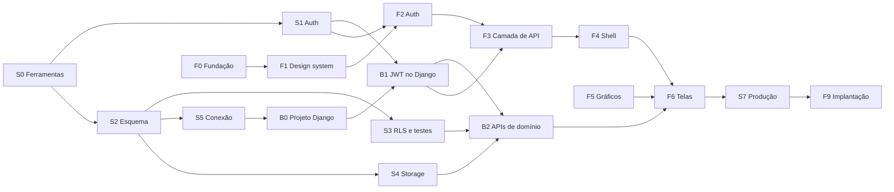

# QuantLab — Plano de Implantação (Supabase, Backend e Frontend)

- **Status:** proposta, à espera das decisões da seção 3.
- **Data:** 2026-11-21
- **Ponto de partida:** motor `0.1.0` pronto (tag `v0.1.0`). Sem código de backend, frontend nem migrações.
- **Andamento (2026-11-21):** S0 feita (`supabase init`, pasta `supabase/`). S2 e S3 **preparadas, não aplicadas**: migração `supabase/migrations/20261121120116_create_core_schema.sql` verificada num Postgres 16 embutido (34 verificações), teste pgTAP escrito e não executado, [ADR 0009](adr/0009-esquema-relacional-e-persistencia.md) e [roteiro de aplicação](runbook-supabase.md). Falta a senha do banco para aplicar e o Docker ligado para a pilha real.
- **Relação com outros documentos:** este plano detalha as Fases 3, 4 e 5 do [plano de desenvolvimento](plano-de-desenvolvimento.md) e aplica os [ADR 0005](adr/0005-fonte-online-yahoo-finance.md), [0006](adr/0006-research-core.md) e [0007](adr/0007-chaves-supabase-jwks-e-frontend.md). Não há prazos: cada fase tem tamanho (P, M, G) e critério de pronto, como no restante do projeto.

---

## 1. Resumo

Levar o QuantLab de "motor que roda em script" para "plataforma com login, dados privados e telas" em cinco marcos, cada um entregando algo usável:

| Marco | Entrega | Fases |
|---|---|---|
| **v0.2** Fundação | Login funcionando, banco com RLS testada, API autenticada, esqueleto do frontend, CI nas três camadas | S0 a S3, S5, B0, B1, F0 a F4 |
| **v0.3** Análise de mercado | Subir CSV ou buscar no Yahoo, limpar com política explícita, ver preço, retorno, risco e correlação | B2 (dados e análise), F5, F6.2 |
| **v0.4** Sistemas dinâmicos | Mapa logístico, bifurcação e Lorenz 3D com parâmetros ajustáveis | B2 (dinâmica), F6.3 |
| **v0.5** Laboratório | Experimentos com hipótese, semente e reprodução; artefatos no Storage | B2 (pesquisa), S4, F6.4 |
| **v1.0** Produção | Projeto Supabase de produção, domínio, SMTP, backups, endurecimento | S7, S8, F9 |

Três escolhas guiam tudo e estão detalhadas adiante:

1. **O banco é dono do esquema.** As migrações do Supabase criam as tabelas; o Django só as lê e escreve (modelos sem migração).
2. **O navegador só lê; quem escreve é o Django.** A RLS protege a leitura direta e as validações de escrita ficam no backend (RULE 038).
3. **Só o que o motor 0.1 entrega vira tela.** O desenho da interface tem telas de otimização de carteira, backtesting e notebooks, que o motor ainda não tem (seção 8.7).

---

## 2. Ponto de partida (verificado)

| Item | Situação |
|---|---|
| Motor | `0.1.0`, 730 testes, 100% de cobertura, `ruff` e `mypy` limpos. Tag `v0.1.0` na branch `feature/release-0.1`, sem push |
| Supabase de desenvolvimento | Projeto criado em 2026-11-19. A chave publishable responde 200 no endpoint de configuração do projeto. O JWKS publica 1 chave ES256 |
| `.env` | `VITE_SUPABASE_URL` e `VITE_SUPABASE_PUBLISHABLE_KEY` corretas. **`SUPABASE_URL` está errada** (termina em `/rest/v1/`, o que quebra o endereço do JWKS). `DATABASE_URL` ausente ou de exemplo |
| `.env.example` | Sugere `db.<ref>.supabase.co:5432`, a conexão direta, que só funciona em IPv6 (fase S5) |
| Autenticação | ADR 0007: JWKS, só ES256, nenhum segredo guardado |
| Frontend | Só existe `package.json` na raiz, com `supabase-js` e `@supabase/ssr` (este não é necessário no Vite) |
| Desenho | `Assets/`: sistema de design (tokens, estados, componentes) e a tela Overview |

**Pré-requisitos imediatos, antes de qualquer fase:**

- [ ] Corrigir `SUPABASE_URL` para `https://<ref>.supabase.co`, sem caminho.
- [ ] Preencher `DATABASE_URL` com a conexão certa (fase S5) e atualizar o `.env.example`.
- [ ] Conferir em "JWT Signing Keys" do painel qual chave assina os tokens de usuário (a S1 fecha isso com um token real).
- [ ] Mover `package.json` e `package-lock.json` para `frontend/` (F0).

---

## 3. Decisões e recomendações

Eu parto das recomendações abaixo. Troque o que discordar antes de começar a fase indicada.

| # | Decisão | Recomendação | Muda em |
|---|---|---|---|
| D1 | Cadastro de usuários: aberto ou por convite | Aberto só em dev. Em produção, **por convite** até existir necessidade pública. Hoje o projeto de dev tem cadastro livre | S1, S7 |
| D2 | Onde ficam `seed` e `data_hash` | **No experimento**, como no motor. O plano antigo (item 3.1) os põe na execução, mas `reproduces` só compara execuções com a mesma semente e os mesmos dados, então eles pertencem à definição | S2 |
| D3 | Quem é dono do esquema | **Migrações do Supabase.** Modelos do Django com `managed = False`. Um só sistema de migração para o domínio (RULE 029) | S2, B0 |
| D4 | Como o Django acessa o banco | Papel dedicado `quantlab_backend`, com permissões mínimas, filtrando por dono em toda consulta (como o README descreve). RLS como segunda camada. Avaliar depois assumir o papel do usuário a cada requisição | S2, B2 |
| D5 | Conexão do Django | **Pooler em modo sessão** em dev (IPv4). Em produção, conexão direta só se a hospedagem tiver IPv6 | S5 |
| D6 | Hospedagem do frontend e do backend | Frontend: estático com reescrita para `index.html`. Backend: imagem Docker com gunicorn. Provedores a escolher pelos critérios da seção 9.3 | F9, B5 |
| D7 | Plano do Supabase em produção | **Pro.** O plano gratuito pausa projetos após 1 semana de inatividade e não tem backup automático | S7 |
| D8 | Provedor de SMTP | Qualquer um com domínio verificado. O SMTP padrão do Supabase serve só para testes | S7 |
| D9 | Escopo do frontend no MVP | Só o que o motor entrega (seção 8.7) | F4, F6 |
| D10 | Esquemas internos do Django | Esquema separado `backend`, fora da API de dados (fase S2) | S2, B0 |

---

## 4. Fases e dependências



S0 a S3 e F0 a F1 não dependem um do outro e podem andar em paralelo.

---

## 5. Ambientes e segredos

| Ambiente | Supabase | Backend | Frontend | Uso |
|---|---|---|---|---|
| **local** | Projeto de dev (ou pilha local via Docker) | `localhost:8000` | `localhost:5173` | Desenvolvimento |
| **dev** | Projeto de dev | Hospedagem de testes | Preview por pull request | Integração e revisão |
| **prod** | **Projeto separado** (RULE 028) | Hospedagem de produção | Domínio próprio | Usuários |

Nunca compartilhe credenciais entre dev e prod.

| Variável | Quem lê | Observação |
|---|---|---|
| `SUPABASE_URL` | Backend | URL base do projeto, sem caminho. Deriva o JWKS e o emissor |
| `SUPABASE_ANON_KEY` | Backend | Chave publishable (ou a antiga `anon`) |
| `SUPABASE_SECRET_KEY` | Backend | **Só quando o Storage for usado** (S4). Ignora a RLS. Nunca no frontend |
| `DATABASE_URL` | Backend | Papel `quantlab_backend` (S2/S5) |
| `DJANGO_*`, `CORS_ALLOWED_ORIGINS` | Backend | `DJANGO_DEBUG=False` e chave nova em produção |
| `VITE_SUPABASE_URL`, `VITE_SUPABASE_PUBLISHABLE_KEY` | Frontend | Públicas, entram no pacote. Só valores públicos |
| `VITE_API_BASE_URL` | Frontend | Endereço da API Django |
| Segredos do CI | GitHub | Ambientes `dev` e `prod`, com aprovação obrigatória para `prod`. Token do Supabase **com escopo mínimo**, não o token clássico de conta |

---

## 6. Plano do Supabase

> **Fontes verificadas em 2026-11-20** na documentação oficial: exposição de tabelas à API de dados, conexões, chaves de assinatura, SMTP e planos. O Supabase muda com frequência, então reconfira o que for crítico no dia de executar.

### S0 — Ferramentas e estrutura (P)

1. Instalar a CLI do Supabase (Scoop no Windows, ou `npx supabase`) e conferir `supabase --version`. Descobrir comandos sempre por `--help`.
2. `supabase init` cria `supabase/` na raiz do repositório. Versionar `config.toml` (sem segredos).
3. `supabase link --project-ref <ref de dev>` (pede a senha do banco, que fica numa variável de ambiente e não no Git).
4. **Migrações imperativas** (`supabase migration new <nome>`), compatíveis com o `supabase/migrations/` do README. As políticas RLS ficam **dentro das migrações**, junto das tabelas. A pasta `policies/` do README deixa de existir e é substituída por `supabase/tests/` (testes de RLS). Atualizar o README.
5. Docker Desktop é opcional e habilita a pilha local (`supabase start`) e os testes de banco no CI.

**Pronto quando:** `supabase link` funciona e `supabase migration list` roda sem erro.

### S1 — Configuração de Auth em dev (P)

| Ajuste | Valor |
|---|---|
| Site URL | `http://localhost:5173` |
| Redirect URLs | `http://localhost:5173/**`. Os de produção entram na S7 |
| Provedor | E-mail e senha, com **confirmação de e-mail** |
| Login anônimo | **Desligado.** Usuários anônimos recebem o papel `authenticated` e passariam por políticas que só checam o papel |
| Cadastro | Conforme D1 |
| SMTP | O padrão só envia a endereços da equipe do projeto e permite 2 e-mails por hora, o que basta para dev |
| Chaves de assinatura | Confirmar a chave ES256 como atual em "JWT Signing Keys" |
| Duração do token | Manter a padrão (1 hora) |

**Pronto quando:** um usuário de teste se cadastra, confirma o e-mail, entra e o script de verificação confirma que o token de acesso tem `alg = ES256` e um `kid` presente no JWKS do projeto. Isso fecha a dúvida aberta no ADR 0007 sobre qual chave assina os tokens de usuário.

### S2 — Esquema e migrações (M)

Convenções (regras do Postgres do projeto): nomes em minúsculas com `snake_case`; chaves `uuid` com `gen_random_uuid()`; `timestamptz`; `jsonb` para parâmetros, métricas e ambiente; **índice em toda chave estrangeira**; restrições `check` para o que o motor já garante. Valores monetários exigiriam `numeric` (RULE 041), mas nenhuma coluna guarda dinheiro: métricas estatísticas ficam em `jsonb`.

A chave estrangeira **composta** `(experiment_id, user_id)` garante que uma execução nunca aponte para um experimento de outro usuário, mesmo que o backend erre.

```sql
create table public.projects (
  id uuid primary key default gen_random_uuid(),
  user_id uuid not null references auth.users (id) on delete cascade,
  name text not null check (length(btrim(name)) > 0),
  description text,
  created_at timestamptz not null default now(),
  unique (id, user_id)
);

create table public.experiments (
  id uuid primary key default gen_random_uuid(),
  user_id uuid not null references auth.users (id) on delete cascade,
  project_id uuid not null,
  name text not null check (length(btrim(name)) > 0),
  hypothesis text not null check (length(btrim(hypothesis)) > 0),
  model text not null,
  parameters jsonb not null default '{}'::jsonb,
  seed bigint not null check (seed between 0 and 9007199254740991),
  data_hash char(64) check (data_hash ~ '^[0-9a-f]{64}$'),
  engine_version text not null,
  created_at timestamptz not null default now(),
  unique (id, user_id),
  foreign key (project_id, user_id)
    references public.projects (id, user_id) on delete cascade
);

create table public.experiment_runs (
  id uuid primary key default gen_random_uuid(),
  user_id uuid not null references auth.users (id) on delete cascade,
  experiment_id uuid not null,
  metrics jsonb not null,
  environment jsonb not null,
  started_at timestamptz not null,
  execution_time_ms double precision not null check (execution_time_ms >= 0),
  created_at timestamptz not null default now(),
  foreign key (experiment_id, user_id)
    references public.experiments (id, user_id) on delete cascade
);

create table public.dataset_records (
  id uuid primary key default gen_random_uuid(),
  user_id uuid not null references auth.users (id) on delete cascade,
  symbol text not null,
  source text not null,
  frequency text not null check (frequency in ('1d', '1wk', '1mo')),
  adjusted boolean not null,
  currency text,
  start_date date not null,
  end_date date not null,
  row_count integer not null check (row_count >= 0),
  data_hash char(64) not null check (data_hash ~ '^[0-9a-f]{64}$'),
  storage_path text,
  created_at timestamptz not null default now(),
  unique (user_id, data_hash)
);

create index on public.projects (user_id);
create index on public.experiments (user_id);
create index on public.experiments (project_id, user_id);
create index on public.experiment_runs (user_id);
create index on public.experiment_runs (experiment_id, user_id);
create index on public.dataset_records (user_id);
```

O esquema segue os campos de `Experiment`, `ExperimentRun` e `PriceMetadata` do motor (`seed`, `data_hash` e `adjusted` seguem a RULE 040). Em `dataset_records`, `adjusted` e `frequency` são obrigatórios para nunca misturar séries ajustadas e não ajustadas. A semente é limitada a 2^53 − 1, como no motor.

**Esquema interno do Django (D10).** Tudo o que existe em `public` pode ficar alcançável pela API de dados. O Django cria as próprias tabelas (`django_migrations` e outras), e elas não devem ir para `public`:

```sql
create schema backend;
create role quantlab_backend login password '<senha forte, fora do Git>';
grant usage, create on schema backend to quantlab_backend;
grant usage on schema public to quantlab_backend;
alter role quantlab_backend set search_path = backend, public;
-- permissões mínimas nas tabelas do domínio:
grant select, insert, update, delete on public.projects, public.experiments,
  public.experiment_runs, public.dataset_records to quantlab_backend;
-- a RLS é a segunda camada; o Django filtra por dono (D4). Duas formas de o papel
-- do backend enxergar as linhas, a confirmar no dia (não verifiquei qual o Supabase permite):
--   (a) alter role quantlab_backend bypassrls;  (pode exigir permissão que o painel não dá)
--   (b) uma política "to quantlab_backend using (true) with check (true)" em cada tabela
```

Experimentos são **imutáveis** (hipótese, semente e parâmetros não mudam depois de criados): o Django não expõe `PUT`/`PATCH` neles, e uma restrição ou gatilho no banco impede alteração de `seed`, `parameters` e `data_hash`.

**Pronto quando:** `supabase db push` aplica no projeto de dev e `supabase db advisors` (CLI 2.81.3 ou mais nova) não aponta tabela sem RLS.

### S3 — RLS e testes (M)

**Exposição à API de dados.** Segundo a documentação, depende da configuração "Automatically expose new tables". Em projetos existentes, objetos novos em `public` recebem permissões padrão que os tornam alcançáveis. Por isso as migrações **revogam e concedem de forma explícita** e habilitam RLS em tudo:

```sql
alter table public.projects enable row level security;
alter table public.experiments enable row level security;
alter table public.experiment_runs enable row level security;
alter table public.dataset_records enable row level security;

revoke all on public.projects, public.experiments,
  public.experiment_runs, public.dataset_records from anon, authenticated;
-- o navegador só LÊ; toda escrita passa pelo Django (RULE 038):
grant select on public.projects, public.experiments,
  public.experiment_runs, public.dataset_records to authenticated;

create policy projects_select on public.projects for select
  to authenticated using ((select auth.uid()) = user_id);
-- idem para experiments, experiment_runs e dataset_records
```

Regras que valem para toda política: `to authenticated` **junto** com o teste de dono (só o papel não restringe linhas); `(select auth.uid())` em vez de `auth.uid()` solto, para a função ser avaliada uma vez por consulta; nunca usar `user_metadata` do token para autorizar, porque o usuário pode editá-lo; sem `auth.role()`, que está obsoleto. Se algum dia houver política de `update`, ela precisa de `using` **e** `with check`, e de uma política de `select`, senão a atualização falha em silêncio.

**Testes de banco** em `supabase/tests/` (pgTAP), assumindo cada papel:

- [ ] Usuário A não lê projeto, experimento, execução nem conjunto de dados do usuário B.
- [ ] Anônimo não lê nada.
- [ ] `authenticated` não consegue `insert`, `update` nem `delete` pela API de dados.
- [ ] Execução de B não pode ser ligada ao experimento de A (chave composta).
- [ ] Apagar o experimento apaga as execuções (cascata).
- [ ] `seed` fora de 0 a 2^53 − 1 e `data_hash` malformado são rejeitados.

**Pronto quando:** os testes passam e `supabase db advisors` está limpo.

### S4 — Storage (M, no marco v0.5)

| Bucket | Conteúdo | Acesso |
|---|---|---|
| `experiment-artifacts` | Relatórios de limpeza, gráficos, logs | Privado |
| `market-data-cache` | Séries em Parquet (cache do ADR 0002) | Privado |

- Caminho: `{user_id}/{experiment_id}/{arquivo}`, e `{user_id}/{data_hash}.parquet` no cache.
- Políticas em `storage.objects` restringem a pasta ao dono: `(storage.foldername(name))[1] = (select auth.uid())::text`. **Substituir um arquivo (upsert) exige as três políticas, `insert`, `select` e `update`**; com só `insert` a troca falha em silêncio.
- Limites de tamanho e de tipo de arquivo por bucket.
- O Django usa a **chave secreta** (só no servidor) depois de checar a posse, e entrega **URLs assinadas de vida curta** ao navegador. Nunca URL pública (RULE 030).
- Depende do trabalho no motor para gravar Parquet (novo ADR, com `pyarrow`).

### S5 — Conexão do Django com o Postgres (P)

Conforme a documentação atual:

| Conexão | Endereço | IPv4 | Observação |
|---|---|---|---|
| Direta | `db.<ref>.supabase.co:5432` | **Só com o complemento IPv4** | Sem restrições |
| Pooler, modo sessão | `aws-<n>-<região>.pooler.supabase.com:5432` | Sim | Suporta *prepared statements* e cursores. **Recomendada em dev** |
| Pooler, modo transação | `…:6543` | Sim | Sem *prepared statements* no pooler compartilhado. Exigiria `DISABLE_SERVER_SIDE_CURSORS` no Django |

- Em dev, usar o **pooler em modo sessão**: a maioria das máquinas Windows e redes domésticas não tem IPv6. O usuário do pooler tem formato diferente do da conexão direta (inclui a referência do projeto), então copie a string do botão "Connect" do painel.
- `sslmode=require` e `CONN_MAX_AGE` curto.
- **Corrigir o `.env.example`**, que hoje sugere a conexão direta.

### S6 — Fluxo de migrações de dev para produção (P)

1. Escrever com `supabase migration new` e testar na pilha local ou no projeto de dev.
2. Pull request. O CI aplica as migrações numa pilha local vazia, roda os testes pgTAP e `supabase db advisors`.
3. Merge: aplicar em dev (`supabase db push`).
4. Tag de versão: aplicar em produção **depois de aprovação manual** e de conferir o backup.
5. Migração já aplicada nunca é editada. Correção é uma migração nova.

### S7 — Projeto de produção (M, no marco v1.0)

- [ ] Criar projeto **separado**, na região mais próxima dos usuários (conferir se há região no Brasil), com **senha de banco forte**.
- [ ] **Plano Pro** (D7). Em 2026-11-20 o Pro inclui backups diários com 7 dias de retenção, e a recuperação ponto a ponto (PITR) é um complemento pago à parte, perto de US$ 100 por mês. Decidir se o PITR compensa.
- [ ] **SMTP próprio** (D8) com domínio verificado. O padrão só entrega a membros da equipe e limita a 2 e-mails por hora.
- [ ] Site URL e Redirect URLs só do domínio de produção.
- [ ] Cadastro por convite (D1), ou CAPTCHA se continuar aberto.
- [ ] **Migrar para as chaves novas e desativar as antigas.** No painel: "Migrate JWT secret", mudar o backend para a chave publishable, desativar `anon` e `service_role` e só então revogar o segredo legado. Revogar o segredo exige desativar essas duas chaves, porque elas também são JWT assinados por ele. Esperar a validade do token (1 hora por padrão) mais 15 minutos antes de revogar, para não deslogar quem está ativo.
- [ ] Papel `quantlab_backend` com senha própria (S2).
- [ ] `supabase db advisors` e o assistente de segurança do painel sem pendências.

### S8 — Operação (contínuo)

- Revisar logs (Logs Explorer) e os *advisors* a cada versão.
- Ensaiar a restauração de backup uma vez antes de ir para produção.
- Rotação de chave de assinatura: a chave nova entra como reserva, vira a atual e a antiga fica como "usada anteriormente", sem derrubar sessões.
- Acompanhar custo e uso do projeto.

---

## 7. Plano do Backend (apoio)

O pedido principal é Supabase e frontend, mas eles dependem destas etapas.

### B0 — Projeto Django (M)

- `backend/` como projeto `uv` separado, no mesmo *workspace* do motor, depende de `quantlab` e de `quantlab_connectors` (extra `yahoo`).
- Dependências: Django (versão LTS vigente), Django REST Framework, drf-spectacular, django-cors-headers, `psycopg`, uma biblioteca de JWT com suporte a JWKS, gunicorn.
- Configurações `base`, `local`, `production` lendo variáveis de ambiente; `DEBUG=False` e `ALLOWED_HOSTS` explícitos em produção.
- Modelos do domínio com `managed = False` (D3). O `migrate` do Django usa só o esquema `backend`.
- Ferramentas: `ruff`, `mypy` (com stubs do Django), `pytest-django`.

### B1 — Autenticação (M)

Implementa o ADR 0007 em `apps/accounts/` com `SupabaseJWTAuthentication`:

- Chave pública pelo `kid` do cabeçalho, no JWKS de `SUPABASE_URL/auth/v1/.well-known/jwks.json`. Cache local de alguns minutos (a borda do Supabase já guarda 10 minutos e as bibliotecas cliente mais 10), com nova busca limitada quando aparecer `kid` desconhecido.
- **Só `ES256`.** `none`, `HS*` e `RS*` rejeitados.
- Verifica `exp`, `iss`, `aud` e `sub` como UUID. Os valores esperados de `iss` e `aud` devem ser confirmados com o token real da S1.
- Testes unitários com um par de chaves gerado no teste e um JWKS falso, sem rede. Um teste de contrato com token real fica marcado `network`.
- Um usuário apagado continua com token válido até ele expirar. Para operações sensíveis, considerar validar a sessão.

### B2 — APIs de domínio (G)

Cada rota chama o motor, que continua sendo o único lugar com cálculo científico (RULE 019):

| App | Rotas (todas em `/api/v1/`) | Chama no motor |
|---|---|---|
| `market_data` | Enviar CSV; buscar no Yahoo; relatório de integridade e de limpeza; listar conjuntos | `CsvPriceProvider`, `YahooPriceProvider`, `check_ohlcv_integrity`, `clean_ohlcv`, `hash_data` |
| `quantitative_analysis` | Retornos, volatilidade, Sharpe, drawdown, VaR e CVaR, correlação | `simple_returns`, `annualized_volatility`, `sharpe_ratio`, `max_drawdown`, `historical_var`, `historical_cvar`, `correlation_matrix` e `plot_*` |
| `dynamical_systems` | Órbita, pontos fixos e Lyapunov do mapa logístico; diagrama de bifurcação; trajetória, equilíbrios e limiar de Hopf do Lorenz | `simulate_logistic_map`, `logistic_fixed_points`, `logistic_lyapunov_exponent`, `logistic_bifurcation_diagram`, `simulate_lorenz`, `lorenz_fixed_points`, `lorenz_hopf_rho` |
| `research` | Projetos, experimentos (criar e ler, sem editar), executar, comparar, **reproduzir** | `Experiment`, `run_experiment`, `ExperimentRun.reproduces` |

Regras de segurança que não são negociáveis:

- **A execução de experimentos usa um registro de modelos no servidor** (`logistic_map`, `lorenz`, `performance`): o campo `model` escolhe uma função que já existe no backend. **Nunca se executa código vindo do usuário.**
- Os gráficos saem como JSON do Plotly gerado pelo motor, e o frontend só desenha (ADR 0003).
- Toda consulta filtra pelo dono (D4), com teste automatizado que falha se uma rota esquecer o filtro.
- Limites de custo: `n_steps` máximo, número máximo de ativos, tamanho máximo de CSV e *throttling* do DRF nas rotas pesadas.
- Erros do motor viram respostas padronizadas: `InputValidationError` em 400/422, `SymbolNotFoundError` em 404, `DataSourceError` em 502 ou 503, `ComputationError` em 422.

### B3 — Contrato da API (P)

OpenAPI por `drf-spectacular`, versão no caminho, paginação e filtros explícitos (RULE 021). O esquema OpenAPI é **versionado** e alimenta os tipos do frontend (F3). Mudança incompatível exige versão nova.

### B4 — Trabalho demorado (condicional)

Síncrono enquanto a resposta ficar abaixo de cerca de 5 segundos. Celery e Redis entram só quando medições mostrarem necessidade (RULE 023); a variável `REDIS_URL` já está comentada no `.env.example`.

### B5 — Qualidade e implantação (M)

Testes de unidade e de API contra um Postgres real (a pilha local do Supabase), cobertura acompanhada. Imagem Docker, `gunicorn`, rota de saúde, logs sem segredos, cabeçalhos de segurança.

---

## 8. Plano do Frontend

### F0 — Fundação (M)

- Mover `package.json` e `package-lock.json` para `frontend/` e remover `@supabase/ssr`.
- Vite, React e TypeScript em modo estrito (`strict`, `noUncheckedIndexedAccess`), regra de lint que proíbe `any` (RULE 031).
- Pastas pelas regras: `src/{components,pages,services,hooks,contexts,types,theme}` (RULE 032).
- **Versões fixas e `package-lock.json` versionado**, com `npm ci` no CI, como recomenda o guia de segurança do Supabase.
- Ícones Lucide, fontes Inter, IBM Plex Mono e JetBrains Mono **hospedadas localmente** (sem CDN, para a política de segurança de conteúdo).

### F1 — Sistema de design (M)

Do desenho em `Assets/`:

- `src/theme/tokens.ts` exporta as cores e o `tailwind.config.ts` as importa. A fonte da verdade dos valores é o motor (`engine/quantlab/visualization/theme.py`). Cores: fundo `#0B0F14`, `#111820`, superfície `#17212B`; borda `#263442`; texto `#E8EDF2` e `#8997A5`; positivo `#16C784`; negativo `#EA3943`; analítico `#3B82F6`; ciência `#8B5CF6`; alerta `#F5A623`. Raios 3, 5 e 6 px, grade de 4 px, linha de tabela de 34 px.
- Componentes: botão (padrão, hover, foco, ativo, desabilitado, carregando), campo (padrão, foco, erro, sucesso, desabilitado), selo (`SUCCESS`, `RUNNING`, `FAILED`, `QUEUED`, `DEMO DATA`, `DYNAMICAL`), abas, dica de gráfico, aviso, esqueleto de carregamento, estado vazio, estado de erro, painel, tabela densa, cartão de indicador.
- **Princípios do desenho como regras de revisão:** a cor nunca vai sozinha (valor com sinal leva ▲/▼ e +/−); todo gráfico tem a pergunta que responde escrita acima; dado sintético leva selo `DEMO`; correlação usa azul↔âmbar, não verde↔vermelho.
- Teste de paridade: os valores de `tokens.ts` batem com o modelo de gráficos do motor (`quantlab_template`), para tela e gráfico não divergirem.

### F2 — Autenticação (M)

- `AuthProvider` (contexto) com `supabase-js` criado a partir de `VITE_SUPABASE_URL` e `VITE_SUPABASE_PUBLISHABLE_KEY`.
- Páginas de cadastro, confirmação, entrada, recuperação de senha e saída; rotas protegidas (`RequireAuth`).
- No navegador, a sessão fica em `localStorage`. O risco é um script injetado (XSS) roubar o token, e a defesa é a política de segurança de conteúdo (F8), nenhum `dangerouslySetInnerHTML` e dependências auditadas.
- A tela só decide a **experiência**; quem autoriza é o backend. Nada de segurança depende do que o navegador acha do próprio usuário.

### F3 — Camada de API (M)

- `services/apiClient.ts`: `fetch` com o `Bearer` do token atual. Em 401, tenta renovar a sessão uma vez e, se falhar, sai. Erros viram um tipo `ApiError` com mensagem útil.
- **Tipos gerados do OpenAPI** (`openapi-typescript`) em `src/types/api.d.ts`; o CI regenera e falha se houver diferença sem commit, então o contrato do backend não se desalinha em silêncio.
- Dados do servidor por TanStack Query, com um hook por recurso (`useExperiments`, `useAnalysis`), e componentes visuais sem acesso a API (RULE 033).
- Um componente `AsyncBoundary` impõe os **quatro estados** da RULE 034: carregando (esqueleto), erro (com "tentar de novo"), vazio (com a ação que resolve) e sucesso.

### F4 — Estrutura da aplicação (M)

Barra lateral, topo e rotas, com carregamento preguiçoso por tela (o Plotly é pesado). Só aparecem os itens que existem; o resto fica oculto ou marcado "em breve" (D9).

### F5 — Gráficos (M)

- Componente `PlotlyChart` que recebe a figura em JSON do backend e a desenha com `react-plotly.js` e `plotly.js-dist-min`, **carregados sob demanda**.
- Sem recalcular nada no navegador (ADR 0003).
- Responsivo, com dica ao passar o mouse, exportar PNG, e **tabela com os dados e um resumo em texto** para quem não enxerga o gráfico.
- Orçamento de tamanho do pacote, com o Plotly num bloco separado.

### F6 — Telas do MVP (G), em ordem

1. **Entrada, estrutura e Overview**, com indicadores reais (quantidade de projetos, experimentos e execuções). O que for sintético leva selo `DEMO`.
2. **Estudo de mercado e risco** (v0.3): enviar CSV ou buscar no Yahoo, **escolher as políticas de limpeza de forma explícita** (RULE 017) e ver o relatório de integridade; gráficos de preço, patrimônio com drawdown, distribuição com VaR e CVaR, volatilidade móvel e correlação.
3. **Simulador de sistemas dinâmicos** (v0.4): mapa logístico com `r` em [0, 4], órbita, pontos fixos e Lyapunov; diagrama de bifurcação; Lorenz com σ, ρ, β, condição inicial e tempo, atrator 3D, equilíbrios e o limiar de Hopf (ρ ≈ 24,74).
4. **Laboratório de pesquisa** (v0.5): projetos; experimento com hipótese obrigatória, semente e parâmetros; executar; histórico; comparar execuções; botão **"Reproduzir"**, que refaz a execução e mostra se as métricas batem, com a tolerância visível.

### F7 — Qualidade (M)

Vitest e Testing Library para componentes, MSW para simular a API, Playwright para os fluxos de ponta a ponta (entrar, enviar CSV, rodar o logístico, criar experimento e reproduzir), checagem de acessibilidade (axe), `tsc --noEmit`, ESLint e Prettier.

### F8 — Segurança do frontend (P)

- **Política de segurança de conteúdo** pela hospedagem: scripts só da própria origem; conexões só para o Supabase e a API.
- **Nenhum segredo no pacote:** o CI falha se achar `sb_secret_`, `service_role` ou um JWT no resultado do build. Só variáveis `VITE_*` públicas.
- `npm audit` no CI e versões fixas.

### F9 — Implantação (M, no marco v1.0)

- `vite build` gera arquivos estáticos; a hospedagem precisa reescrever qualquer rota para `index.html`.
- As variáveis `VITE_*` entram **na hora do build**, então há um build por ambiente: *preview* de cada pull request aponta para o Supabase de dev, e o build de produção sai da tag e aponta para o de produção.
- Domínio próprio com HTTPS. Atualizar Site URL e Redirect URLs do Supabase e o `CORS_ALLOWED_ORIGINS` do Django só com a origem real.

### 8.7 O que o desenho pede e o motor 0.1 entrega

| Seção do menu do desenho | Motor 0.1 | No MVP? |
|---|---|---|
| Overview | Parcial: só contadores reais | Sim |
| Returns Analysis, Risk Analytics, Correlation Matrix | Sim | Sim (v0.3) |
| Market Data | Sim: CSV e Yahoo | Sim (v0.3) |
| Discrete Systems, Continuous Systems, Stability, Bifurcation, Chaos Lab | Sim: logístico e Lorenz | Sim (v0.4) |
| Research Projects, Experiments, Simulation History | Sim | Sim (v0.5) |
| Watchlists, Asset Explorer | Não | Não |
| Portfolio Optimization, Strategy Lab, Backtesting | **Não** | **Não**, dependem de módulos novos no motor (Fase 6) |
| Notebooks, Reports | Não | Não |
| Account, Preferences, Data Sources, API Configuration | Parcial | Só Account |

O desenho tem dados sintéticos e a nota "demo build". A regra do desenho se mantém: o que não for real leva selo `DEMO`, ou não aparece.

---

## 9. CI/CD e implantação

### 9.1 Pipelines (GitHub Actions)

| Arquivo | Quando | O que faz |
|---|---|---|
| `ci.yml` (existe) | Push e pull request | Motor e conectores: lint, formato, `mypy`, testes e cobertura, Python 3.12 e 3.13 |
| `backend.yml` | Mudança em `backend/` | Lint, tipos, testes contra Postgres real, **esquema OpenAPI atualizado** |
| `frontend.yml` | Mudança em `frontend/` | `npm ci`, `tsc`, ESLint, Vitest, build, checagem de segredos no pacote, Playwright |
| `supabase.yml` | Mudança em `supabase/` | Pilha local vazia, aplica as migrações, testes pgTAP, `supabase db advisors` |
| `deploy.yml` | Tag `v*` | Migrações em produção (com aprovação), imagem do backend, build do frontend |

### 9.2 Segredos no CI

Ambientes `dev` e `prod` do GitHub, com aprovadores obrigatórios para `prod`. O CLI do Supabase usa um **token de acesso com escopo** limitado ao projeto e às permissões necessárias, nunca o token clássico, que dá acesso a toda a conta. A senha do banco entra por variável de ambiente.

### 9.3 Critérios para escolher a hospedagem (D6)

Latência para o Brasil e para a região do Supabase; custo previsível; suporte a contêiner Docker; IPv6 (para a conexão direta) ou saída estável; domínio e HTTPS automáticos; *preview* por pull request; registros acessíveis; reversão rápida de versão. Eu não comparei preços de provedores, então esse item precisa de pesquisa no dia da decisão.

---

## 10. Checklist de segurança (transversal)

- [ ] Nenhum `service_role` nem `sb_secret_` no frontend, no Git ou em log (RULE 028).
- [ ] RLS ativa em toda tabela, com `to authenticated` **e** teste de dono; testada com pgTAP.
- [ ] Nenhuma decisão de acesso baseada em `user_metadata`.
- [ ] Sem `SECURITY DEFINER` para "resolver" erro de permissão; visões criadas com `security_invoker = true`.
- [ ] Papel do backend com permissões mínimas; tabelas internas do Django fora de `public`.
- [ ] JWT validado só com ES256, `iss`, `aud`, `exp` e `sub`.
- [ ] Execução de experimentos só de modelos registrados no servidor.
- [ ] Limites de tamanho, de passos e de requisições nas rotas pesadas.
- [ ] Política de segurança de conteúdo; versões fixas e lockfile; `npm audit`.
- [ ] Produção com projeto, chaves e banco **separados** de dev.
- [ ] Chaves antigas desativadas depois da migração, e o segredo legado revogado.

---

## 11. Riscos

| Risco | Efeito | Mitigação |
|---|---|---|
| Yahoo via `yfinance` é não oficial e pode quebrar | Busca online para de funcionar | CSV local continua; teste de contrato `network` avisa cedo |
| Plano gratuito pausa após 1 semana sem uso e não tem backup | Perda de disponibilidade ou de dados | Pro em produção; dev tolera pausa |
| Política RLS errada | Vazamento entre usuários | Testes pgTAP, *advisors*, leitura só pelo navegador, escrita só pelo Django |
| Django criar tabelas em `public` | Tabelas internas expostas | Esquema `backend` e `search_path` do papel (D10) |
| Conexão direta sem IPv6 | Backend não conecta | Pooler em modo sessão em dev (D5) |
| Confusão de algoritmo no JWT | Token forjado aceito | Lista fixa com só ES256 |
| Revogar o segredo legado cedo demais | Usuários deslogados | Esperar a validade do token mais 15 minutos |
| Cálculos pesados travam a API | Indisponibilidade | Limites, *throttling*, e Celery quando medido |
| Pacote do Plotly grande | Primeira carga lenta | Carregamento sob demanda, orçamento de tamanho |
| Desenho promete telas que o motor não tem | Escopo infla | Seção 8.7; módulos novos só pela Fase 6 |
| Mudanças frequentes do Supabase | Passos desatualizados | Conferir a documentação no dia de executar cada fase |

---

## 12. Critério de pronto por marco

**v0.2 Fundação**
- [ ] Um usuário se cadastra, confirma o e-mail e entra pelo frontend.
- [ ] O token tem `alg = ES256` e a API Django o valida; `GET /api/v1/me` devolve o `sub`; token falso, expirado ou com algoritmo trocado recebe 401.
- [ ] Os quatro conjuntos de testes de RLS passam e os *advisors* estão limpos.
- [ ] O CI roda as quatro camadas e o OpenAPI gera os tipos do frontend sem diferença.
- [ ] Nenhum segredo no repositório nem no pacote do frontend.

**v0.3, v0.4, v0.5**
- [ ] Cada tela do marco funciona de ponta a ponta com dados reais, com os quatro estados de interface.
- [ ] Teste de ponta a ponta do fluxo principal.
- [ ] Todo número exibido veio do motor; selo `DEMO` onde for sintético (RULE 060).

**v1.0 Produção**
- [ ] Projeto de produção separado, SMTP próprio, backups conferidos e restauração ensaiada.
- [ ] Chaves antigas desativadas, domínio com HTTPS, política de segurança de conteúdo ativa.
- [ ] Checklist da seção 10 completo.

---

## 13. Próximos passos imediatos

1. Corrigir `SUPABASE_URL` e preencher a `DATABASE_URL`; atualizar o `.env.example` (seção 2 e fase S5).
2. Responder às decisões D1 a D10 que você discordar da recomendação.
3. Executar **S0 e S1**, que destravam o resto, e em paralelo **F0 e F1**.
4. ~~Abrir o ADR do esquema (D2, D3, D4 e D10)~~ Feito: ADR 0009. A migração inicial já existe e espera ser aplicada (siga o [roteiro](runbook-supabase.md)).
